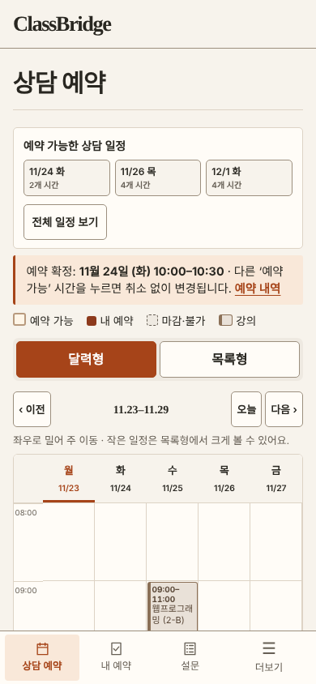
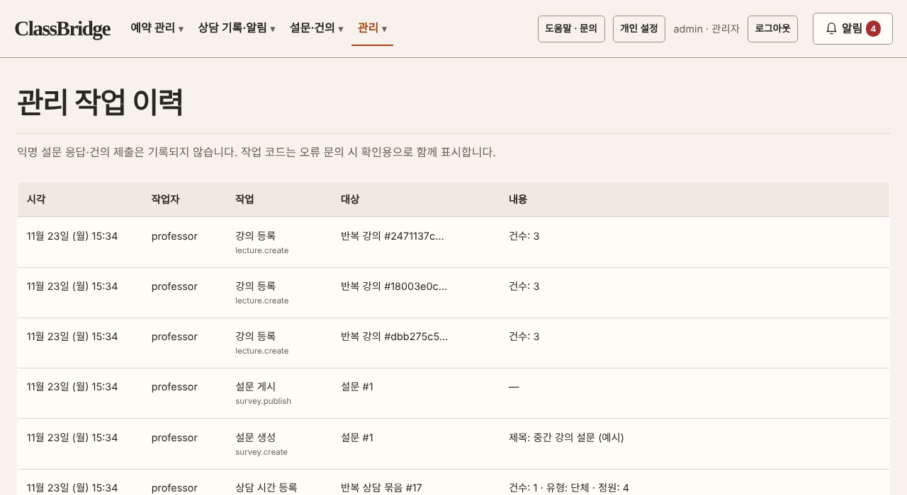

# ClassBridge

교수자 1명, 최고 관리자 1명, 다수 학생을 위한 **상담 예약 · 강의 설문 · 익명 건의함** 통합 웹서비스.

- **스테이징**: https://classbridge-staging.onrender.com (허용된 테스트 계정만 로그인 가능 · [로그인 없는 익명 건의 화면](https://classbridge-staging.onrender.com/static/suggest.html)은 누구나 열람 가능)
- **개발 브랜치**: `staging` (작업 브랜치 → PR → `staging` → Render 수동 배포)

| 학생 · 모바일 상담 예약 | 교수자 · PC 주간 시간표 |
|---|---|
|  |  |
| **교수자 · 상담 기록·통계** | **관리자 · 작업 이력** |
|  |  |

<sub>화면은 가상 데이터(`scripts/seed_demo.py`)로 캡처했습니다.</sub>

## 주요 기능

| 역할 | 할 수 있는 일 |
|---|---|
| 학생 | 주간 시간표에서 상담 예약 · 취소 없이 시간 변경 · 내 달력(.ics) 추가 · 설문 응답 · 익명 건의 (비로그인은 비공개만) |
| 교수자 | 상담 시간·강의 등록(한 문장 입력 지원) · 학생 대신 예약 · 상담 결과·비공개 기록 · 통계 · 알림(앱·Gmail·Android 푸시) · 설문 작성·결과 |
| 관리자 | 계정·역할 관리(검색·필터) · 운영 설정 · 관리 작업 이력 · 개발자 문의함 |

## 기술 스택과 설계 요점

- 백엔드: FastAPI · SQLAlchemy 2 · Alembic · PostgreSQL(운영, Neon) / SQLite(개발)
- 프론트엔드: 빌드 없는 ES 모듈 (PC 주간 시간표 / 모바일 주간·목록 보기, PWA)
- 인증: Google OpenID Connect, 서버 세션 + CSRF 토큰, 스테이징 계정 허용 목록
- 동시 예약 무결성: 원자적 좌석 차감 + PostgreSQL 경쟁 테스트(일부러 버그를 넣으면 실패하는지 확인한 변이 검증 포함)
- 익명성: 참여 기록과 응답을 분리 저장, 소수 응답 보호, 접근 로그 차단 — **보장 범위와 한계**는 [anonymity.md](docs/anonymity.md)
- 보안 헤더: CSP(`script-src 'self'`), HSTS, `X-Frame-Options: DENY`, nosniff

> ⚠️ 실제 학생 개인정보를 받기 전에 [docs/pre-launch-checklist.md](docs/pre-launch-checklist.md)를 완료해야 합니다.

## 빠른 실행 (개발)

```bash
python -m venv .venv && source .venv/bin/activate
pip install -r requirements-dev.txt
cp .env.example .env          # 필요 시 수정
set -a && source .env && set +a
alembic upgrade head
python scripts/seed_demo.py   # 가상 데이터 (선택)
uvicorn app.main:create_app --factory --reload
```

http://localhost:8000 에서 개발용 로그인을 사용합니다.
- `admin@example.ac.kr` → 관리자, `professor@example.ac.kr` → 교수자 (`.env`의 목록 기준)
- 그 외 이메일 → 학생 (`seed_demo.py`를 실행했다면 `student1@test.ac.kr`~`student5@test.ac.kr`)

## 테스트

```bash
pytest                                   # 단위 + 통합 (SQLite)
TEST_PG_URL=postgresql+psycopg://user@host:5432/db pytest tests/postgres   # 실제 PostgreSQL 동시성·마이그레이션
python -m playwright install chromium && RUN_E2E=1 pytest tests/e2e        # 브라우저 E2E (PC·모바일)
ruff check app tests migrations scripts
```

## 문서

| 문서 | 내용 |
|---|---|
| [architecture.md](docs/architecture.md) | 계층 구조, 의존 관계, 폴더 구조, 무결성 보장 방식 |
| [permissions.md](docs/permissions.md) | 학생·교수자·관리자 권한표 |
| [database.md](docs/database.md) | 스키마, 제약, 마이그레이션, DB 계정 권한 |
| [api.md](docs/api.md) | API 명세 (코드에서 자동 생성, `scripts/gen_api_doc.py`) |
| [anonymity.md](docs/anonymity.md) | 익명성 설계, 건의 남용 방지와 **남은 한계** |
| [deployment.md](docs/deployment.md) | Render·Neon·Google OAuth 배포, 백업·롤백·장애 대응 |
| [operations-runbook.md](docs/operations-runbook.md) | 운영 절차 |
| [test-report.md](docs/test-report.md) | 테스트 보고서, 검증된/검증 안 된 항목 구분 |
| [pre-launch-checklist.md](docs/pre-launch-checklist.md) | 공개 배포 전 사용자 작업 목록 |
| [releases/](docs/releases/) | 날짜별 변경 기록(릴리스 메모) |

운영 점검: `python scripts/retention_report.py` — 개인정보처리방침의 보관기간(365일)을 넘긴 기록 **건수만** 조회합니다(삭제하지 않음).

### 상담 우선 표시와 예약

등록된 상담은 겹치는 강의보다 우선합니다. 강의가 겹쳐도 상담의 예약·시간 변경·대리 예약 및 예약 가능 날짜 조회에는 강의 차단을 적용하지 않습니다. 정원, 예약 마감, 주말 제한과 권한 검사는 유지합니다. 기존 예약을 침범하는 새 강의 등록은 계속 거부합니다.

학생 상담 예약·변경 작성창에서 휴대폰/브라우저 뒤로가기는 창만 닫습니다. 시간표 URL과 선택 주차는 유지하며, 창을 닫은 다음 뒤로가기는 원래 페이지 이동으로 동작합니다.

학생 시간표는 로그인 사용자 전용 조회 API로 강의명·시간·강의실을 표시합니다. 강의 수정·삭제 및 관리용 조회 권한은 확대하지 않습니다. 겹치는 구간은 상담을 우선 표시합니다. 화면 알림은 터치/클릭 또는 키보드 Enter·Space·Escape로 즉시 닫을 수 있습니다.

## 캘린더 초대 독립 시험 (미배포)

`exp/calendar-invite-test` 전용. 앱·DB·큐·Render 설정을 변경하지 않는다.
발신 `sender@example.com`, 수신 `recipient@example.com` 본인 계정만 사용한다.
로컬 가상환경에 `icalendar`, `httpx`를 설치하고 기존 발신 인증 4개
(`GMAIL_CLIENT_ID`, `GMAIL_CLIENT_SECRET`, `GMAIL_REFRESH_TOKEN`, `GMAIL_SENDER_EMAIL`)를
프로세스 환경변수로 제공한다. 비밀값은 코드/명령 이력/보고서에 넣지 않는다.

```sh
python scripts/dev/send_test_invite.py --self-test
python scripts/dev/send_test_invite.py request --to recipient@example.com --dry-run
python scripts/dev/send_test_invite.py update --to recipient@example.com --dry-run
python scripts/dev/send_test_invite.py cancel --to recipient@example.com --dry-run
# 실제 순서: request → 폰 확인 및 30분 전 알림 확인 → update → 폰 확인 → cancel
python scripts/dev/send_test_invite.py request --to recipient@example.com --send
python scripts/dev/send_test_invite.py update --to recipient@example.com --send
python scripts/dev/send_test_invite.py cancel --to recipient@example.com --send
```

기본은 dry-run이며 상태 파일을 만들거나 발송 횟수를 소모하지 않는다.
각 dry-run은 합성 미리보기다. 실제 세 번의 발송은 `.invite_state.json`의
같은 UID와 증가하는 SEQUENCE를 사용한다. 파일을 삭제/복사하여 한도를 초기화하지 않는다.
발송 시도는 최대 3회이며 네트워크 결과 불명 또는 중단 시 재시도하지 않는다.
명령 동시 실행은 파일 잠금으로 차단한다. 실행 환경은 Linux/macOS이다.
Gmail API 접수 성공은 수신·캘린더 반영·알림 성공을 의미하지 않는다.

실행 순서 및 현재 결과 (2026-11-24):
1. request/update/cancel dry-run 전문 출력 및 icalendar 재파싱 완료. 오프라인 단위 테스트 2개 통과.
2. 개발자 승인 후 request --send. Render의 별도 임시 폴더에서 기존 프로세스 환경변수로 시도. Google 인증 갱신이 HTTP 400 / invalid_grant / expired or revoked로 실패하여 메일 API 호출 전 중단. 실제 발송 0통, 자동 재시도 없음. 인증값 노출 및 운영 설정 변경 없음.
3. 개발자가 30분 전 알림 확인 후 update --send, 중복 여부 확인. 미실행.
4. cancel --send, 삭제 또는 취소 표시 확인. 미실행.

| 질문 | 기대·확인 기준 | Gmail 웹 실제 | Gmail 앱 실제 | Google 캘린더 실제 | 삼성 캘린더 실제 | 비고 |
|---|---|---|---|---|---|---|
| 1 초대 카드 | 참석/미정/불참 제공 여부 | 개발자 입력 | 개발자 입력 | 해당 없음 | 해당 없음 | 파일 첨부 표시와 구분 |
| 2 수락 전 등록 | 수락 전·후 따로 기록 | 개발자 입력 | 개발자 입력 | 개발자 입력 | 개발자 입력 | 초대 자동 추가 설정 기록 |
| 3 일정·시간 | 두 앱에서 동일 한국시간 | 개발자 입력 | 개발자 입력 | 개발자 입력 | 개발자 입력 | 시작은 실제 발송 시각+40분 |
| 4 사전 알림 | 시작 30분 전 실제 알림 | 해당 없음 | 해당 없음 | 개발자 입력 | 개발자 입력 | VALARM 적용인지 앱 기본값인지 구분 |
| 5 시간 변경 | 같은 일정 1개, 15분 이동 | 개발자 입력 | 개발자 입력 | 개발자 입력 | 개발자 입력 | 수동 ICS 가져오기는 별도 기록 |
| 6 취소 | 삭제 또는 취소 표시 | 개발자 입력 | 개발자 입력 | 개발자 입력 | 개발자 입력 | 앱별 동기화 지연 기록 |

결론: 실기기 관찰 전이므로 학생 알림 방식 채택 여부는 미정.
자동 추가/VALARM이 수신자 설정에 따라 다르면 메일+선택적 캘린더 초대만 제공하고,
정시 알림은 기존 웹 푸시 또는 별도로 검증한 알림톡을 검토한다. 이번 시험에서 연결하지 않는다.

추가 확인: 수신자 누락·동일 주소·복수 주소·인증 누락의 4가지 거부 검증 통과. 현재 시험 상태는 중복 발송 방지를 위해 잠겨 있으며 인증 복구 후 실패 단계 확인 없이 상태를 초기화하지 않는다. 기존 알림메일도 동일 인증을 사용하므로 운영 메일 영향 점검이 필요하다.
