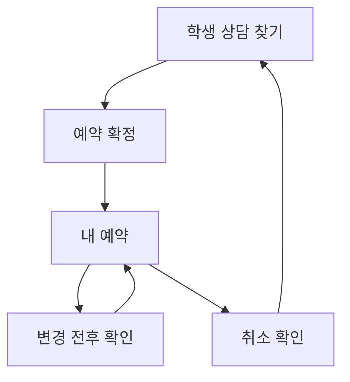
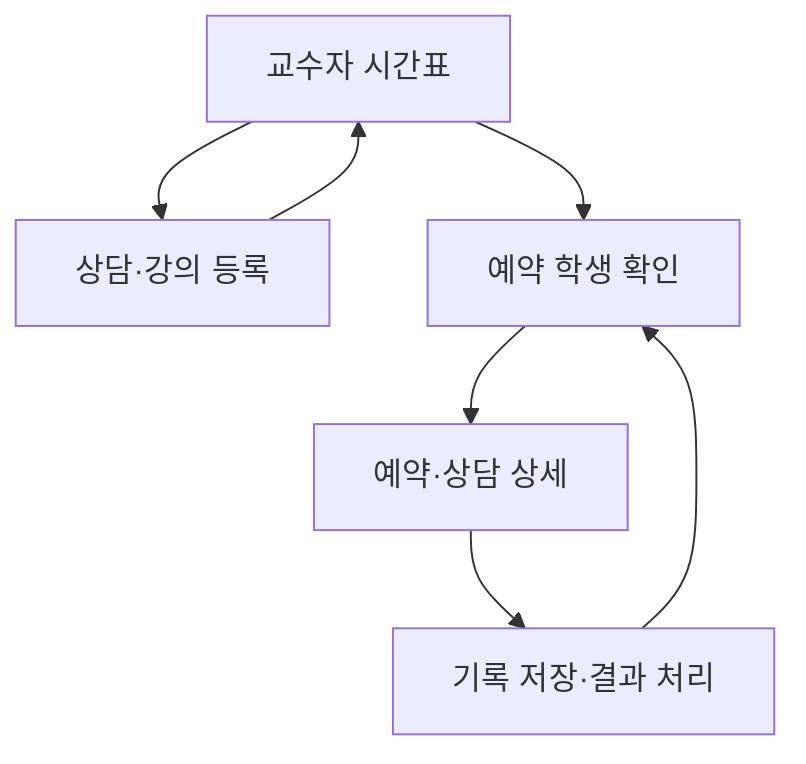
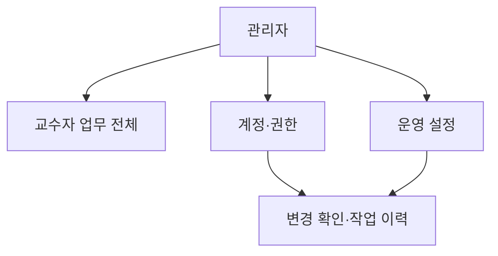

# ClassBridge 역할별 사용 흐름·모바일 점검

대상: PR #80, staging 기반. 학생·교수자·관리자, 360px / 390px / 1366px.
실서비스 관리자 화면은 읽기만 점검했다. 학생·교수자·관리자 반복 검증과 예약 변경·취소·기록 작성은 격리된 테스트 계정·데이터로 수행한다.

## 역할별 핵심 흐름

| 역할 | 주요 순서 | 확인할 결과 |
|---|---|---|
| 학생 | 상담 예약 → 예약 가능한 날짜/시간 → 정보 입력 → 내 예약 → 시간 변경 또는 취소 | 날짜 숫자는 예약 가능 시간 수. 변경 전후를 확인하고 같은 예약 ID 유지. 다른 학생 이름·교수자 비공개 기록 미노출 |
| 교수자 | 시간표 → 일정 등록 → 예약 관리 → 오늘 상담 또는 전체 목록 → 예약·상담 상세 → 기록 저장/결과 처리 | 날짜 숫자는 예약된 학생 수. 이름·시간 확인, 단체 학생 선택, 저장 전 이탈 보호 |
| 관리자 | 교수자 흐름 전체 + 더보기 → 관리 → 계정·권한/운영 설정/작업 이력 | 교수자 기능 유지. 역할 변경·비활성화·삭제의 영향 안내와 확인. 학생·교수자 메뉴에 관리자 기능 미노출 |

## 근거와 개선

1. **역할별 날짜 집계 모순 수정**
   - `prof-slots.js`가 `dayCountMode`를 넘기지 않아 학생용 기본 집계를 사용했다. 예약 관리의 캘린더는 이미 booked 모드를 사용해 같은 역할 안에서도 불일치했다.
   - 교수자·관리자는 booked 상태 예약 인원, 학생은 `bookable=true` 시간 수로 명확히 분리한다. 단체 3명 + 개인 1명은 4명, 예약 가능한 시간 2개는 학생에게 2로 표시한다.
   - 목록 상단에 숫자의 의미를 설명한다. 전체 가입 학생 수나 취소·완료 상담 누적 인원이 아니다.
2. **오늘 업무 탐색 단축 및 모바일 밀도 개선**
   - `staff-today.js`의 ‘오늘 예약’이 전체 목록 `#/bookings`로 이동했다. 이미 구현된 `#/bookings/today`로 직접 연결한다.
   - 오늘 상담에서 전체 예약 관리로 돌아올 수 있고 하단 예약 관리 탭을 선택 상태로 유지한다.
   - 모바일 ‘오늘 할 일’ 버튼을 2열로 배치하고 제목·간격을 줄여 학생 목록이 아래로 과도하게 밀리는 현상을 완화한다. 터치 높이 44px을 유지한다.
3. **관리자 계정 작업 오조작 여지 완화**
   - 계정·권한 화면의 비활성화·계정 삭제 버튼이 붙어 있었다. 두 버튼 사이를 분리한다.
   - 기존 확인 절차, 마지막 관리자 보호, 연결 기록 검사, 서버 권한은 그대로 유지한다.

## 유지한 동작

- 학생의 ‘취소 없이 시간 변경’: 예약 취소→재예약을 유도하지 않으며 변경 전후 확인 후 같은 예약을 수정한다.
- 교수자·관리자의 기록 편집: 공통 상세창에서 학생 선택, 기록 저장, 완료·미참석 수정. 저장하지 않은 내용을 버릴 때 확인한다.
- 역할별 하단 메뉴: 학생은 상담 예약·내 예약·설문, 교수자·관리자는 시간표·예약 관리·내 알림. 추가 업무는 더보기.
- 강의는 따뜻한 갈색 계열로 유지하고 상담 예약 상태와 구분한다.

## 검증 범위와 한계

- 새 회귀 검사: 개인·단체·취소·강의·빈 날짜의 역할별 집계.
- 새 브라우저 검사: 세 역할 × 세 폭, 목록 숫자, 메뉴 열기/닫기, 관리자 전용 메뉴, 페이지 가로 넘침, 오늘 상담 왕복 이동 및 화면 캡처.
- 기존 전체 검사: 학생 예약·취소·같은 ID로 시간 변경, 교수자 상담 기록·결과 처리, 관리자 교수자 기능 및 권한 변경, 설문·건의·알림 등.
- Chromium 모바일 화면 크기 검증이며 실제 Android/iOS 기기·화면 키보드·Safari 전체 동작을 확인한 것은 아니다.
- 실제 서비스 데이터의 변경·삭제·예약 발송은 실행하지 않았다. 이 PR은 별도 배포 요청 전까지 미배포 상태다.
- 최종 CI 결과와 캡처 검토 결과는 PR #80에 기록한다.
